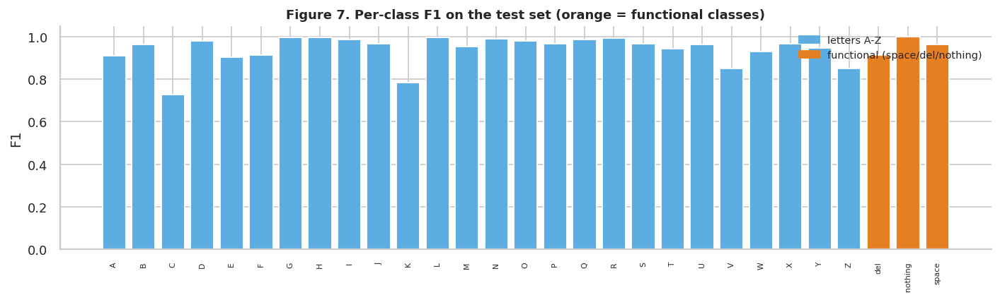
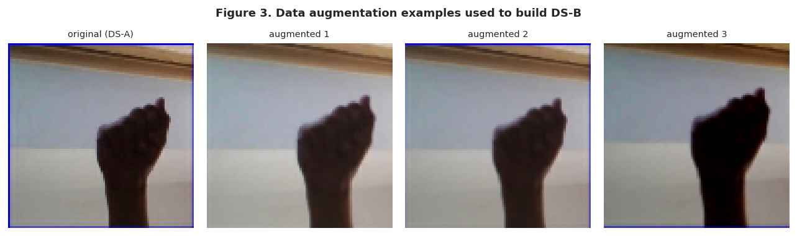
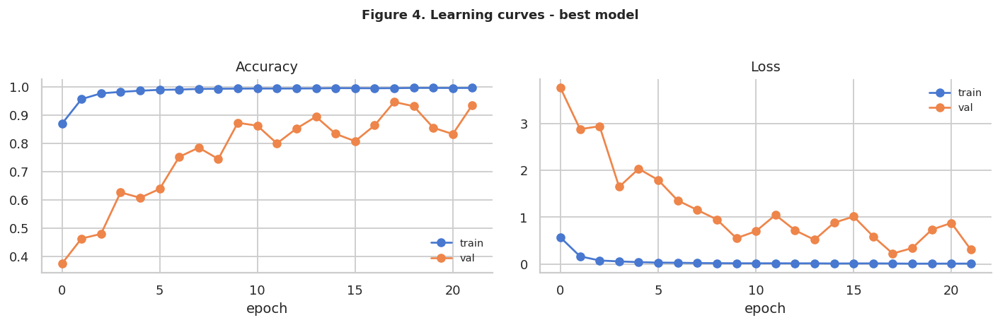
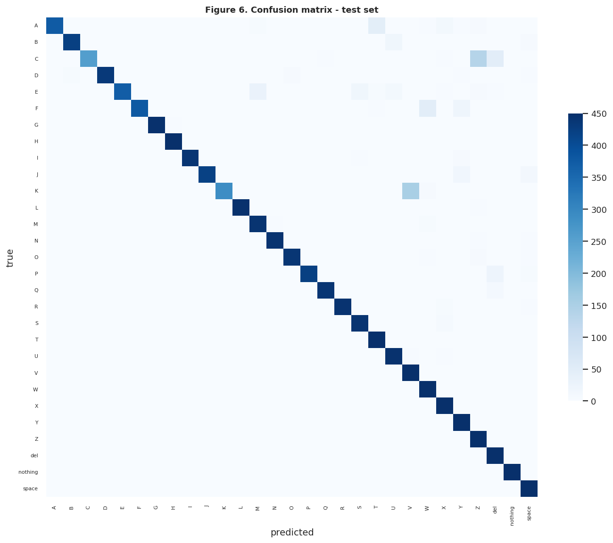
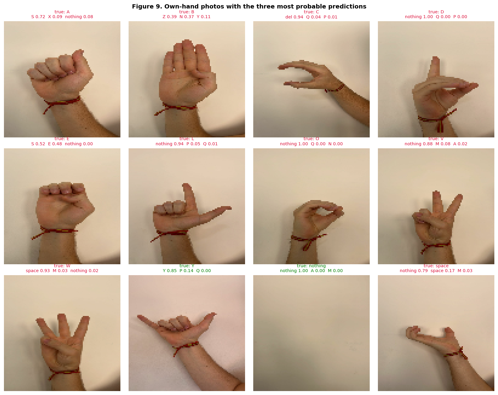

# 94 % en el test, 2 de 12 con mis manos: una CNN para el alfabeto de signos americano

> Una red convolucional hecha desde cero en Keras que reconoce las **29 clases del alfabeto ASL**
> (26 letras + SPACE, DELETE y NOTHING). En el test del dataset roza el 94 %. Con fotos de mis propias
> manos, acierta 2 de 12. Este repo va de las dos cifras, y sobre todo de por qué no coinciden.

| Experimento | Test accuracy | Test macro-F1 |
|---|---|---|
| **Mejor CNN** (3×3, 4 bloques, lr 1e-3, dropout 0.3, con aumento) | **0.943** | **0.941** |
| Misma CNN sin aumento de datos | 0.751 | 0.751 |
| Misma CNN sin dropout | 0.852 | 0.842 |



---

## Índice

- [Filosofía: cada afirmación, un experimento](#filosofía-cada-afirmación-un-experimento)
- [Los datos](#los-datos)
- [La red](#la-red)
- [Qué ha aprendido (y qué no)](#qué-ha-aprendido-y-qué-no)
- [La prueba de fuego: mis manos](#la-prueba-de-fuego-mis-manos)
- [Lo que me llevo](#lo-que-me-llevo)
- [Siguientes pasos](#siguientes-pasos)
- [Cómo ejecutarlo](#cómo-ejecutarlo)

---

## Filosofía: cada afirmación, un experimento

- **Nada de "el dropout ayuda" sin pruebas.** El efecto del aumento de datos y el del dropout se miden
  entrenando la misma red con y sin ellos, sobre el mismo test.
- **Un único split para todo.** DS-A (sin aumento) y DS-B (con aumento) comparten el mismo reparto
  estratificado 70/15/15: la única diferencia entre ellos es el aumento.
- **Aumento que respeta el problema.** Brillo, contraste y zoom, pero sin volteos: un espejo cambia el
  significado de algunas letras.
- **Arquitectura compacta.** *Global average pooling* en lugar de `Flatten`: ≈0.46 M de parámetros.

## Los datos

[ASL Alphabet](https://www.kaggle.com/datasets/grassknoted/asl-alphabet) (Kaggle): 87 000 imágenes RGB
de 200×200, unas 3 000 por clase (balanceado). Redimensionadas a 96×96 y reescaladas a [0, 1];
etiquetas one-hot y *categorical cross-entropy*.



## La red

Bloques conv + batch norm + max pooling, early stopping que restaura la mejor época y selección por
macro-F1 en validación:

| Modelo | Kernel | Bloques | Learning rate | Dropout | Val macro-F1 |
|---|---|---|---|---|---|
| **CNN_cfg1** | 3 | 4 | 0.001 | 0.3 | **0.967** |
| CNN_cfg2 | 5 | 4 | 0.0005 | 0.4 | 0.954 |
| CNN_cfg3 | 3 | 5 | 0.0005 | 0.3 | 0.802 |



## Qué ha aprendido (y qué no)

- **Aumento de datos:** sube el macro-F1 en test de 0.751 a 0.941 y estabiliza el entrenamiento.
- **Dropout:** quitarlo baja el macro-F1 de 0.938 a 0.842; sin él, la cabeza densa memoriza el
  entrenamiento.
- **Sorpresa:** NOTHING, que parecía la clase difícil, es la mejor de las 29 (F1 0.999).
- **Errores residuales:** se concentran en letras con formas parecidas, C ↔ Z (F1 0.73) y K ↔ V
  (F1 0.78).



## La prueba de fuego: mis manos

12 fotos de mis manos (10 letras + SPACE y NOTHING), evaluadas con el modelo final sin reentrenar.



Acierta 2 de 12, y los fallos no son aleatorios: varios gestos se clasifican como NOTHING. El modelo se
apoya en el fondo y el encuadre del dataset, que son muy uniformes, además de en la forma de la mano.
Este pequeño test cuantifica el **salto de dominio** entre el dataset y el mundo real, algo que el 94 %
del test interno no deja ver.

## Lo que me llevo

- Una CNN compacta hecha desde cero alcanza un **0.94 de macro-F1** en las 29 clases.
- El aumento de datos y el dropout son las dos decisiones que más aportan, y ambas están medidas.
- Para un uso real, la prioridad no es una red más grande sino **datos más variados**: manos, fondos e
  iluminación distintos. Un buen número en test no es lo mismo que un buen modelo.

## Siguientes pasos

- Aumento con fondos variados (segmentar la mano y pegarla sobre fondos aleatorios).
- Grad-CAM para ver qué zonas de la imagen usa la red.
- Un test propio más grande, con varias personas y entornos.

## Cómo ejecutarlo

Pensado para Google Colab con GPU. Requiere `tensorflow`, `kagglehub` (con cuenta de Kaggle),
`numpy`, `scikit-learn`, `matplotlib` y `seaborn`.

```
asl_cnn.ipynb   notebook completo: análisis → DS-A/DS-B → configuraciones → evaluación → ablaciones → fotos propias
figures/        figuras exportadas
```

---

Proyecto desarrollado durante el Grado en Ingeniería de Sistemas de Inteligencia Artificial
(Universidad Francisco de Vitoria, 2025/26). Autor: Marco Larriba Rius.
